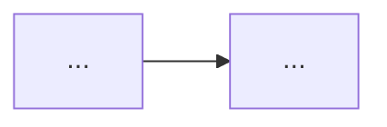

# 답안·키워드 생성 가이드 (정보관리기술사)

입력: `contentwork/secN.json` — 토픽 배열 `[{id, title, title_en, aliases, subs, questions[]}]`
출력:
1. `content/SEC/{topic id}.json` — 토픽마다 1파일
2. `contentwork/keywords-secN.json` — 이 묶음에서 링크한 키워드 전부

## 1. 토픽 파일 형식

```json
{
  "id": "t-xxxxxxxx",
  "answers": { "short": "<1교시형 Markdown>", "long": "<서술형 Markdown>" },
  "keywords": ["kw-id-1", "kw-id-2"]
}
```
`keywords`: 두 답안에 링크된 키워드 id 전부(중복 없이).

## 2. 답안 양식 — 실제 기술사 답안지 구조

### 1교시형 (10점, 답안지 1페이지 ≈ 22줄 분량, 400~600자)

```markdown
## 1. {토픽}의 개요
- 정의: 한 문장 (핵심 키워드 링크)
- 필요성/등장배경: 한 문장

## 2. {토픽}의 개념도 및 구성요소

| 구성요소 | 역할 |
|---|---|
| ... | ... |

## 3. {토픽}의 특징 (또는 유형·비교·동작절차)
| 구분 | 내용 |
|---|---|

## 4. 고려사항 (또는 기대효과·발전방향)
- ...
```

### 서술형 (25점, 답안지 3페이지 ≈ 66줄 분량, 1,500~2,200자)

```markdown
## 1. {토픽}의 개요
### 가. 정의
### 나. 등장배경 / 필요성
### 다. 핵심 개념 (표 또는 3항목 목록)

## 2. {토픽}의 구성도 및 구성요소
### 가. 구성도
```mermaid
flowchart TB ...
```
### 나. 구성요소 (표: 구성요소 | 역할 | 핵심기술)
### 다. 동작 절차 (번호 목록 또는 표)

## 3. {토픽}의 상세 (유형·기법·비교·적용사례 중 문항에 맞는 것)
### 가. ...
### 나. ...

## 4. {토픽} 적용 시 고려사항 및 발전방향
| 구분 | 고려사항 |
|---|---|

## 5. 결론 (한두 문장)
```

- 문항이 특정 측면(`subs`, `questions` 참고)을 요구하면 3장을 그 측면에 맞춤. 예: "RTO·RPO 관점 비교"면 비교표 필수
- 기출 문항이 여러 개면 가장 최근·포괄적인 문항 기준으로 쓰되 다른 문항의 요구사항도 3장에 반영
- 문장은 기술사 답안 톤: 명사형 종결, 표·도식 우선, 불필요한 서술 금지
- 숫자·표준·법령은 정확히 (예: ISO/IEC 27001:2022, 개인정보보호법 제29조). 불확실하면 연도·조항 생략
- 다이어그램은 반드시 ```` ```mermaid ```` 블록 (flowchart·sequenceDiagram). 노드 라벨에 괄호·특수문자는 따옴표로: `A["PKI(공개키 기반구조)"]`
- Markdown 표 머리행 필수. 표 안에서 `|` 사용 금지

## 3. 키워드 링크

- 답안 본문의 **전문용어 전부** 링크. 표기: `[[kw-id|화면 표시]]` 예: `[[public-key-infrastructure|PKI]]`
- 한 답안에서 같은 키워드는 **첫 등장만** 링크
- 토픽 자신의 이름은 링크하지 않음
- `kw-id` 규칙: 영문 소문자 kebab-case, **영문 정식 명칭** 기준. 널리 약어로만 불리는 것만 약어 (`vpn`, `pki`, `ssl-tls`, `otp`, `ddos`, `xss`, `isms-p`)
  - 좋음: `digital-signature`, `hash-function`, `zero-trust`, `role-based-access-control`
  - 나쁨: `전자서명`, `DigitalSignature`, `rbac-model`(→ `role-based-access-control`)
- 같은 개념은 반드시 같은 id. 묶음 안에서 일관되게

## 4. 키워드 파일 형식

```json
[
  {
    "id": "digital-signature",
    "term": "전자서명",
    "term_en": "Digital Signature",
    "definition": "1~2문장 정의",
    "features": ["핵심 특징 3~5개, 각 한 줄"],
    "related": ["hash-function", "pki"]
  }
]
```
- 이 묶음 답안에서 링크한 모든 id가 빠짐없이 있어야 함
- `related`: 이 묶음에서 쓴 id 중에서만. 없으면 `[]`
- `definition`과 `features`는 위키 독립 페이지로 읽히게, 토픽 답안 내용과 중복돼도 됨

## 5. 작업 절차

1. 입력 파일 Read
2. 토픽 1개씩 답안 2개 작성 → `content/SEC/{id}.json` Write (한 토픽 = 한 Write)
3. 전부 끝나면 키워드 파일 Write
4. python3로 검증: 모든 토픽 파일 유효 JSON, answers.short/long 비어있지 않음, 답안의 `[[id|...]]` id 집합 == keywords 파일 id 집합 ⊇ 각 토픽 keywords
5. 결과(토픽 수, 키워드 수, 검증 통과 여부)만 짧게 보고
